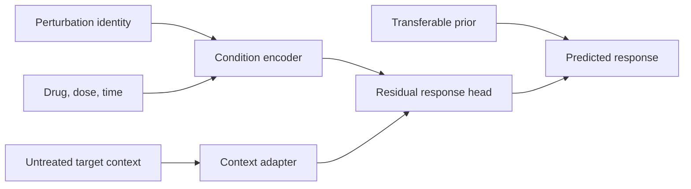

# PRADO-DT

**Prior-anchored Residual Adaptation for Dose–Time OOD transfer**

PRADO-DT is a modular reference implementation for predicting transcriptomic responses to genetic and chemical perturbations when the deployment environment—such as a cell line, donor or tissue state—was not treated during model fitting. It separates a transferable perturbation–drug–dose prior from a context-dependent residual and uses untreated context to adapt the prediction.

The repository is designed for reproducible evaluation. It contains the dependency-light CPU reference runner, optional PyTorch modules, H5AD metadata handling, tests and a user guide. Third-party expression matrices and model checkpoints are intentionally not bundled.

## What the model does



For a held-out environment, the model can use its untreated/control profile while treated labels remain unopened until final evaluation. The core components are:

- a stable perturbation–drug–dose prior;
- a context adapter for untreated target state;
- a dose/time condition encoder with log-stabilized continuous features;
- a residual head that can be used as a full-response, low-rank or mixture ablation;
- source-calibrated interval diagnostics.

The default CPU runner is intentionally transparent and small. The PyTorch implementation is an optional module for larger H5AD inputs and frozen transcriptome encoders.

## Installation

Python 3.9 or newer is supported.

```bash
git clone https://github.com/Qiu-Shizheng/PRADO-DT.git
cd PRADO-DT
python -m venv .venv
source .venv/bin/activate
python -m pip install --upgrade pip
python -m pip install -e .
```

Install optional H5AD support:

```bash
python -m pip install -e ".[data]"
```

Install optional PyTorch modules:

```bash
python -m pip install -e ".[torch]"
```

## Quick start on CPU

The following command creates a deterministic synthetic experiment and writes a compact JSON result to `runs/smoke/`:

```bash
python scripts/run_experiment.py \
  --synthetic --seed 7 \
  --genes 4 --perturbations 3 --drugs 2 \
  --cells-per-condition 1 --epochs 2 \
  --out runs/smoke
```

The installed console entry point is equivalent:

```bash
prado-dt-smoke --synthetic --genes 4 --perturbations 3 --drugs 2 --cells-per-condition 1 --epochs 2
```

The command reports baseline and PRADO-DT MSE, per-gene Pearson correlation, a source-derived interval radius and held-out interval coverage. The synthetic example is a software smoke test; it is not a biological benchmark.

Run the tests with:

```bash
python -m pip install -e ".[dev]"
python -m unittest discover -s tests -v
```

## Run on an H5AD dataset

Prepare an AnnData file with expression values in `adata.X` and observation metadata containing a perturbation identifier and an environment identifier. The runner discovers common column names automatically:

| Concept | Accepted column names |
|---|---|
| Perturbation | `perturbation`, `perturbation_name`, `condition`, `gRNA` |
| Environment | `cell_line`, `celltype`, `cell_type`, `line` |
| Drug | `drug`, `drug_name`, `compound` |
| Dose | `dose`, `perturbation_value`, `concentration` |
| Time | `time`, `hours`, `perturbation_time` |

Untreated context is constructed from non-targeting or control rows at zero dose. Recognized control labels include `NTC`, `control`, `vehicle`, `non-targeting` and `random_region`. A treated row from the held-out environment is never used to construct its context profile.

```bash
python scripts/run_experiment.py \
  --h5ad /path/to/prepared_screen.h5ad \
  --held-out-cell-line U87MG \
  --max-cells 100000 --max-genes 512 \
  --out runs/kinome_u87mg
```

If the dataset uses different metadata names, pass explicit column overrides, for example:

```bash
python scripts/run_experiment.py \
  --h5ad /path/to/screen.h5ad \
  --cell-line-col donor --perturbation-col guide \
  --drug-col compound_name --dose-col concentration --time-col exposure_hours \
  --held-out-cell-line donor_3 --out runs/donor_3
```

The H5AD path is read locally. The package does not download data, upload data or require an external service.

## Python API

```python
from prado_dt import LinearRegressor, condition_features, feature_map

features = condition_features(
    perturbation=3,
    n_perturbations=16,
    dose=1.0,
    time=24.0,
    drug=2,
    n_drugs=8,
)
```

The optional PyTorch module is available after installing the `torch` extra:

```python
from prado_dt.torch_model import PRADODTModel

model = PRADODTModel(
    state_dim=512,
    output_dim=512,
    n_perturbations=256,
    n_drugs=32,
    width=128,
)
```

The PyTorch module expects tensors for `cell_state`, `control_state`, perturbation index, drug index, dose and exposure time. See [the user guide](docs/user_guide.md) for a complete input contract and training outline.

## Output files

Each run writes:

- `metrics.json`: numerical metrics and evaluation semantics;
- `config.json`: command-line configuration;
- `runs/` is ignored by Git so that large predictions and checkpoints stay local.

MSE is averaged over genes and evaluation rows. The interval radius is estimated from source rows and transferred to the held-out environment as a diagnostic. It is not a distribution-free guarantee under arbitrary domain shift.

## Data and model checkpoints

No expression matrix, pretrained checkpoint or private dataset is included. Use the original publication or GEO record for data access, check its license and record the accession and preprocessing choices in your own analysis. Keep H5AD, checkpoint and prediction files outside Git or use a data-archive service designed for large files.

## Scope and limitations

PRADO-DT is a research implementation. It is intended for condition-level response prediction and controlled out-of-distribution evaluation. The package does not claim universal zero-shot accuracy, causal mechanism discovery or superiority over every perturbation foundation model. Results depend on the split definition, control availability, gene axis, dose units and exposure-time protocol. For a publication-quality study, compare against methods on the identical feature axis and split, report external validation separately by estimand, and preserve the full preprocessing manifest.

## Citation

See [CITATION.cff](CITATION.cff). The software is released under the MIT License.

## License

PRADO-DT is distributed under the [MIT License](LICENSE). Third-party data, model weights and gene-set collections retain their own licenses.
