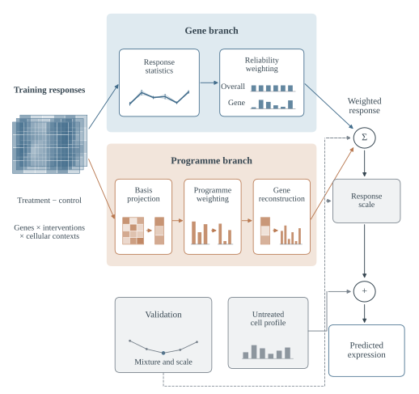

# ContextDose

**Source-selected models for cellular response transfer**

[](LICENSE)
[](pyproject.toml)

ContextDose predicts treatment responses by combining shared source responses with evidence about their consistency. It estimates reliability for an entire compound response and for individual response genes, then selects their mixture using held-out source cell types.

This repository provides runnable CPU models, a NumPy training API, matched input examples and an optional neural reference implementation. The Python package is `prado-dt`.



## Install

```bash
git clone https://github.com/Qiu-Shizheng/PRADO-DT.git
cd PRADO-DT
python -m venv .venv
source .venv/bin/activate
python -m pip install -e .
```

## Predict with a fitted model

```bash
contextdose-predict \
  --model-dir models/response_transfer/op3 \
  --control models/response_transfer/op3/example_control.csv \
  --conditions models/response_transfer/op3/example_conditions.csv \
  --output predictions.npz
```

The example uses a source control to demonstrate the file format. For your experiment, supply an untreated target control on the model's gene axis and expression scale.

| Model | Response genes | Fitting and evaluation setting |
|---|---:|---|
| [OP3 response transfer](models/response_transfer/op3) | 5,317 | B, T and NK source cells; myeloid evaluation from shared donors |
| [Cellarity response transfer](models/response_transfer/primary) | 13,290 | Six cultured source lines; four primary-cell populations |
| [Glioblastoma expression](models/expression) | 512 | A172 fitting, T98G selection and U87MG evaluation |

The response-transfer models predict listed drug–dose–time conditions. The expression model has a separate command documented in its [README](models/expression/README.md).

## Input and output

The control CSV contains `gene_id,expression`. All model genes must occur exactly once, in any order. The condition CSV contains:

```csv
condition_id,drug,dose_uM,time_hours
```

Choose supported combinations from the model's `model.json` or copy its example condition file. Doses are in micromolar and exposure times are in hours. The software rejects unsupported conditions and mismatched genes.

The output NumPy archive contains:

| Array | Meaning |
|---|---|
| `prediction` | Predicted expression, conditions × genes |
| `effect` | Predicted change relative to the supplied control |
| `gene_ids` | Gene order of both output matrices |
| `condition_id` | Input condition identifiers |

OP3 inputs use log1p counts per million across the 5,317 released genes. Cellarity inputs use the original released expression scale. See the [model guide](docs/response_transfer.md) for compatible preprocessing and evaluation scope.

## Python API

```python
from prado_dt import predict_response

prediction, effect, output_genes = predict_response(
    control=control_vector,
    gene_ids=gene_ids,
    compounds=compound_names,
    doses_uM=doses,
    times_hours=exposure_times,
    model_dir="models/response_transfer/op3",
)
```

The control may be one gene vector or one vector per condition.

## Fit your own response model

Provide a NumPy archive containing `effects` with shape **source contexts × shared conditions × genes**, plus `gene_ids`, `drug`, `dose_uM` and `time_hours`. Each effect is measured relative to its matched untreated source control. At least three source contexts are required.

```bash
contextdose-fit \
  --source-effects source_effects.npz \
  --input-scale "log1p CPM across the declared gene panel" \
  --output models/my_response_model
```

The fixed search selects the reliability penalty, compound–gene mixture and response scale by leaving out source contexts. It writes the fitted model and all candidate validation scores. Target treated expression is not an input to this interface.

## Evaluation

In the OP3 development task, the hierarchical gate has MSE **0.074658** and mean response Pearson correlation **0.224**, compared with **0.075912** and **0.193** for the separately selected compound-only gate. The comparison uses 127 drugs and the same 5,317 response genes. Cellarity effects vary by population. The [model guide](docs/response_transfer.md) reports the complete population comparison and scope.

Saved models replay the frozen evaluation predictions to numerical precision. Run the software tests with:

```bash
python -m unittest discover -s tests -v
```

For H5AD loading, the synthetic training runner and optional PyTorch modules, see the [reference implementation guide](docs/user_guide.md).

## Data and citation

The repository includes fitted model parameters and example inputs. Obtain experimental expression matrices from the original studies:

- [OP3, NeurIPS 2024](https://doi.org/10.52202/079017-0650)
- [Cellarity compound-response atlas](https://doi.org/10.1126/science.adi8577)

See [CITATION.cff](CITATION.cff) to cite the software. Code is distributed under the [MIT License](LICENSE). Original datasets retain their source licences.
